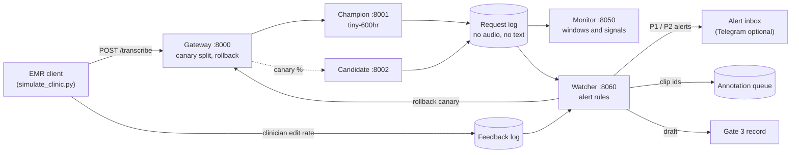

# Amharic Speech Recognition: from Notebook to Production

**A hands-on MLOps lab built around a real Amharic ASR model.** Participants take a working Whisper model and run into the problems that appear once a model leaves the notebook. Each time they propose a fix, then compare it with a tested one.

[](https://www.python.org/)
[](#how-to-run)
[](#how-to-run)
[](tests/)
[](LICENSE)

Built for the MLOps capacity-building workshop with the Ethiopian Artificial Intelligence Institute (EAII), Addis Ababa, 27–30 October 2026.

---

## Purpose

A "Speak" button in the EMR (OpenMRS). A clinician dictates a short note in Amharic, the server returns text, and the clinician corrects it and saves. **You own the speech service.**

The model works. Everything around it is what goes wrong:
- the way it is scored;
- the way the data is split;
- silent and noisy recordings;
- the choice between versions;
- thirty clinicians pressing Speak at once;
- new phones arriving at a facility;
- a cholera outbreak changing the vocabulary;
- a debug flag that writes patient notes into the logs.

## What you will practise

Every episode follows the same pattern: **do the obvious thing → see the issue → pause and propose a fix → apply the tested fix → check it.**

| # | Episode | What goes wrong | What you learn | Lifecycle stage |
|---|---|---|---|---|
| 0 | Set up and check | – | Pinned environment, checksummed data and models | Development |
| 1 | The WER that lies | Raw WER of 49% is mostly spelling variants and punctuation; a token limit silently cuts 11 of 40 outputs | Versioned Amharic normaliser, CER next to WER, tracked runs | Validation |
| 2 | The split that leaks | A random split puts 64% of test sentences in training | Group-aware splits, honest dataset card | Data |
| 3 | Silence that speaks | The model "hears" a word in silence and fan noise | Input validation before the model | Deployment |
| 4 | Better on average, worse for some | The newer model and the int8 model look tempting; both lose on phone audio | Promotion rule written in advance, named Gate 2 approver | Validation · Gate 2 |
| 5 | Thirty clinicians press Speak | 36-43 of 60 requests time out | Backpressure, load testing, capacity planning | Deployment |
| 6 | New phones, then an outbreak | Quality drops with no labels to show it; alerting on every bad request floods the inbox | Label-free monitoring; telling data drift from concept drift; alerts that persist before they fire; automatic, safe responses | Monitoring · Gate 3 |
| 7 | Canary, rollback, and the logs | The canary is worse; a debug flag logs patient text | Automatic canary rollback; privacy by default in logs | Deployment · Monitoring |
| 8 | Do our annotators agree? *(optional)* | Annotators "disagree" on spelling variants | Normalise first, adjudicate real differences | Data |
| 9 | Fine-tune in Colab *(take-home)* | – | Reproducible training on open data (WAXAL) | Development · Re-evaluation |

The full walk-through, with every command and its expected output, is in **[LAB_GUIDE.md](LAB_GUIDE.md)**.

## The simulated production server

Everything runs on one laptop as plain Python processes. Docker is optional.



The **watcher** applies the alert rules in [`configs/params.yaml`](configs/params.yaml). A rule fires only when a signal stays over its threshold for two windows in a row. It sends one message per problem and one when the problem clears. It takes only safe, reversible actions:
- queue clips for annotation;
- open a draft Gate 3 review;
- roll back a canary.

Promoting, retraining and deploying always need a person.

## How to run

**Requirements:** Windows 11 with Git Bash (or Linux/macOS), Python 3.12, [uv](https://docs.astral.sh/uv/), about 2 GB of disk space. No GPU.

```bash
uv venv --python 3.12 .venv
uv pip install -r requirements.lock --python .venv/Scripts/python.exe   # Linux/macOS: .venv/bin/python
source scripts/env.sh
python scripts/download.py          # FLEURS Amharic dev set + two Whisper-tiny models, checksums verified
python scripts/prepare_data.py
pytest -q                           # 39 passed

python -m asr.evaluate --model champion
bash scripts/start_server.sh        # gateway :8000 · monitor :8050 · alerts :8060
python scripts/simulate_clinic.py   # four days of clinic traffic; watch http://127.0.0.1:8060
bash scripts/start_server.sh stop
```

On Linux, install the CPU build of PyTorch to avoid CUDA wheels (`--torch-backend cpu` with uv).

## How to reproduce

- **Environment:** every package is pinned in `requirements.lock` (made with `uv pip compile requirements.txt`).
- **Data and models:** fetched at fixed revisions and checked against SHA-256 hashes (`scripts/downloads.json`).
- **Parameters:** decoding settings, seeds, promotion rule and alert rules all live in `configs/params.yaml`.
- **Runs:** every evaluation is an MLflow run (`mlflow.db`) recording the model, normaliser version, decoding settings and git commit.
- **Fallback:** `results/precomputed/` holds the outputs of the reference run, so any episode can be discussed without running it.

## Results from the reference run

Windows 11, 24 logical CPUs, no GPU. Error rates are deterministic; timings depend on the machine.

| Check | Result |
|---|---|
| Champion `tiny-600hr` on 40 FLEURS clips | WER **35.6%**, CER **12.4%** (raw: 49.3% / 15.6%) |
| Same model with a 225-token limit | WER 40.5%, CER 18.7%: 11 of 40 outputs cut off |
| Candidate `tiny-stage2` | 0.2 WER points better overall, 8.1 CER points worse on long phone audio: **rejected** |
| Champion int8 | 20% smaller, not faster, CER 20.7%: **rejected** |
| Random vs grouped split | 64% vs 0% of test clips share a sentence with training |
| 30 concurrent users | naive: 17-24 of 60 answered, the rest time out; with backpressure: fast 503s, p95 under 8 s |
| New phones (simulated channel) | edit rate 0.115 → 0.792; data-drift alert after 2 windows |
| Outbreak vocabulary (simulated) | edit rate 0.378 with unchanged audio; concept-drift alert |
| Alerting on every bad request | 82 messages for 4 days; with persistence: 3 |
| Canary 50% int8 | edit rate gap +0.07 → rolled back automatically after 30 requests |

## Data and models

| Asset | Source | Licence |
|---|---|---|
| Evaluation audio | [FLEURS](https://huggingface.co/datasets/google/fleurs) Amharic dev set (223 clips, 39 min) | CC-BY-4.0 |
| Champion | [`b1n1yam/shook-tiny-amharic-600hr`](https://huggingface.co/b1n1yam/shook-tiny-amharic-600hr) (Whisper tiny, 151 MB) | Apache-2.0 |
| Candidate | [`b1n1yam/shook-tiny-amharic-stage2-polish`](https://huggingface.co/b1n1yam/shook-tiny-amharic-stage2-polish) | Apache-2.0 |
| Fine-tuning (take-home) | [WAXAL](https://huggingface.co/datasets/google/WaxalNLP) Amharic, 190 h, 566 speakers | CC-BY-SA-4.0 |

Data and models are not stored in git. `scripts/download.py` fetches them at pinned revisions and checks SHA-256 hashes. [`docs/AMHARIC_SPEECH_DATA.md`](docs/AMHARIC_SPEECH_DATA.md) surveys every open Amharic speech dataset we could find, with licences and contamination notes.

## Project layout

```
configs/params.yaml     every parameter: models, decoding, promotion rule, monitoring and alert rules
src/asr/                normalize · metrics · audio gate · engine · evaluate · service · gateway · monitor · watcher
scripts/                download, data preparation, the episode scripts, start_server.sh
tests/                  normaliser, audio gate, API contract and privacy, alert rules
docs/                   dataset card, model card, monitoring plan, Gate 2 template, Amharic data survey
results/precomputed/    outputs of the reference run, a fallback for every episode
notebooks/              Colab fine-tuning on WAXAL (take-home)
LAB_GUIDE.md            the participant guide
FACILITATOR_NOTES.md    timings, discussion questions, fallbacks
```

## Framework check

The workshop's `eaii-mlops check` tool scores a repository against 18 guideline rules. This project passes all of them except two, on purpose:
- **GOV-01 (no approved Gate 2 record):** filling in that record is the closing exercise of the lab.
- **LOG-01 (warning):** the command-line reports print to the terminal; the services themselves log in a structured way.

## Owner

Biniyam Belayneh and Abenezer (ASR facilitators), for the Palladium–EAII MLOps workshop.

Code is released under the [MIT licence](LICENSE). Data and models keep their own licences (table above).
